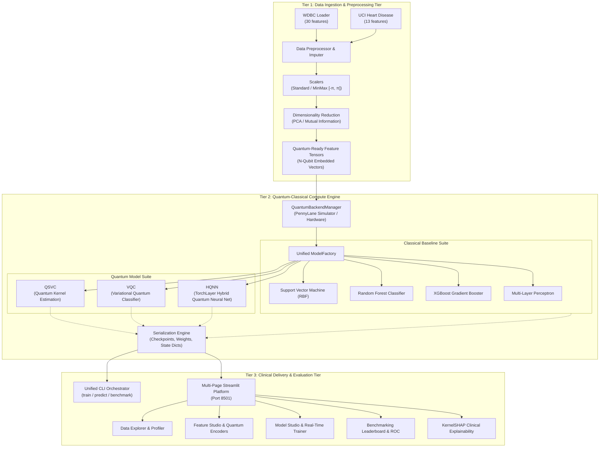
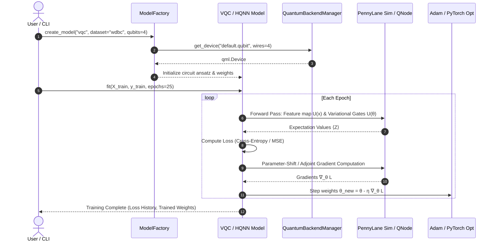

# Hybrid Quantum-Classical Clinical Diagnostics Architecture

## 1. Executive Summary & Architectural Overview

The **Hybrid Quantum-Classical Machine Learning (QML) Clinical Diagnostics Platform** is engineered to investigate and leverage quantum computational advantages (such as kernel expressivity in high-dimensional Hilbert spaces) for high-stakes medical diagnosis tasks—specifically Breast Cancer (WDBC) and Cardiovascular Disease (Heart Disease).

The system follows a strict **3-Tier Modular Architecture** decoupling ingestion and dimensionality adaptation, hybrid quantum-classical algorithmic execution, and interactive clinical delivery with explainable AI (XAI).


---

## 2. Three-Tier Architectural Topology



---

## 3. Tier 1: Data & Preprocessing Tier

### 3.1 Supported Medical Datasets
1. **Wisconsin Diagnostic Breast Cancer (WDBC)**:
   - 569 patient samples (357 Benign, 212 Malignant).
   - 30 nuclear morphology continuous features extracted from digitized fine needle aspirate (FNA) images.
2. **Cardiovascular Heart Disease**:
   - 303 patient records across 13 clinical biomarkers (resting BP, cholesterol, ECG, thalach, etc.).
   - Binary target: Presence of heart disease ($0$ vs $1$).

### 3.2 Feature Adaptation for NISQ Constraints
Noisy Intermediate-Scale Quantum (NISQ) devices are constrained by qubit counts ($N \in [2, 8]$) and circuit coherence times. The preprocessing pipeline applies:
- **MinMaxScaler $[-\pi, \pi]$ or $[0, \pi]$**: Scaled for quantum rotational gates ($R_x, R_y, R_z$).
- **Principal Component Analysis (PCA)**: Retains $>85\%$ variance within $N=4$ or $N=6$ orthogonal eigenvectors.
- **Mutual Information (MI) Selection**: Non-linear feature selection ranking top informational biomarkers for direct quantum encoding.

---

## 4. Tier 2: Quantum-Classical Compute Engine

### 4.1 Quantum Backend Management
The `QuantumBackendManager` abstracts the underlying execution substrate:
- `default.qubit`: High-performance state-vector simulator supporting analytic adjoint differentiation.
- `lightning.qubit`: Fast C++ OpenMP state-vector accelerator.
- `qiskit.aer` / Noise Channels: Optional depolarizing and phase-damping noise models simulating physical transmon qubits.

### 4.2 Quantum Model Formulations

#### 4.2.1 QSVC (Quantum Support Vector Classifier)
Maps classical vectors $\mathbf{x} \in \mathbb{R}^N$ to quantum states $|\Phi(\mathbf{x})\rangle$ in Hilbert space $\mathcal{H}$:
$$K(\mathbf{x}_i, \mathbf{x}_j) = |\langle \Phi(\mathbf{x}_i) | \Phi(\mathbf{x}_j) \rangle|^2$$
The quantum kernel matrix is computed via PennyLane state inner products and ingested by a dual-formulation soft-margin Support Vector Classifier.

#### 4.2.2 VQC (Variational Quantum Classifier)
Consists of:
1. **State Preparation / Feature Map**: Angle Embedding $\mathcal{U}_\Phi(\mathbf{x}) = \bigotimes_{k=1}^N R_y(x_k)$.
2. **Parameterized Variational Circuit (Ansatz)**: Strongly entangling layers with $R_x(\theta), R_y(\theta), R_z(\theta)$ rotations and circular CNOT entanglement topologies.
3. **Measurement**: Expectation values $\langle \hat{Z}_0 \rangle$ mapped to class logits via a classical linear head:
   $$\hat{y} = \sigma\left(w \cdot \langle \psi(\mathbf{x}, \mathbf{\theta}) | \hat{Z}_0 | \psi(\mathbf{x}, \mathbf{\theta}) \rangle + b\right)$$
4. **Optimization**: Analytic Parameter-Shift Rule or Adjoint Jacobian with Adam/SGD.

#### 4.2.3 HQNN (Hybrid Quantum Neural Network)
Combines PyTorch classical dense layers with a parameterized quantum layer via `pennylane.qnn.TorchLayer`:
$$\mathbf{x} \xrightarrow{\text{Linear}(D_{\text{in}} \to N)} \mathbf{z} \xrightarrow{\text{Quantum Layer}(N)} \mathbf{q} \xrightarrow{\text{Linear}(N \to 1)} \hat{y}$$
Backpropagation flows seamlessly through classical weights via reverse-mode autodiff and through the quantum circuit via the parameter-shift gradient theorem:
$$\frac{\partial \langle \hat{O} \rangle}{\partial \theta_i} = \frac{\langle \hat{O} \rangle_{\theta_i + \frac{\pi}{2}} - \langle \hat{O} \rangle_{\theta_i - \frac{\pi}{2}}}{2}$$



---

## 5. Tier 3: Clinical Delivery & Evaluation Tier

### 5.1 Interactive Web Platform (Streamlit)
The web platform provides clinicians and researchers with an intuitive graphical workstation:
- **Data Explorer**: Dataset profiling, statistical moments, missingness detection, and correlation matrices.
- **Feature Studio**: Interactive dimensionality reduction (PCA variance scree, Mutual Information) and quantum feature-encoding visualizations.
- **Model Studio**: Live model training dashboard with animated loss curves and session checkpointing.
- **Leaderboard**: Comparative evaluation matrix across all 7 algorithms (Accuracy, Sensitivity, Specificity, F1, ROC-AUC, Wall-clock time).
- **Explainability (XAI)**: Model-agnostic KernelSHAP feature importances translating quantum representations into clinical biomarker attributions.

### 5.2 Unified CLI Orchestrator
Standardized terminal interface for headless execution, automated batch pipelines, and HPC cluster scripts:
```bash
python cli.py train --model vqc --dataset wdbc --qubits 4 --epochs 25 --lr 0.05
python cli.py predict --model checkpoints/vqc_wdbc.pt --input sample.json
python cli.py benchmark --dataset heart --qubits 4
```

---

## 6. Serialization & Checkpoint Specifications

| Model Class | Storage Format | Serialized Components |
|---|---|---|
| **Classical (SVM, RF, XGB, MLP)** | `.joblib` / `.pkl` | Fitted estimator, feature scalers, hyperparameter dict |
| **PyTorch HQNN** | `.pt` / `.pth` | `state_dict`, optimizer state, network architecture config |
| **VQC / QSVC** | `.pt` / `.json` | Variational weights tensor, bias, quantum circuit specs, precomputed kernels |

---

## 7. Sign-off & Ratification
- **Member A (Architecture & CLI):** Approved
- **Member B (Quantum Backend & Circuits):** Approved
- **Member C (Testing & Benchmarks):** Approved
- **Member D (Platform, DevOps & Docs Lead):** Approved
